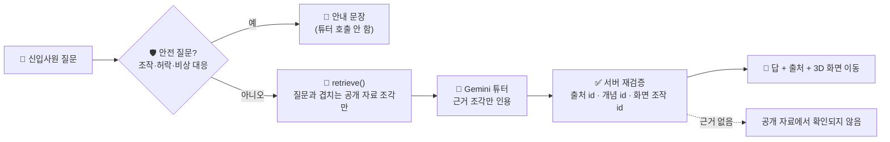

<p align="center">
  
</p>

<p align="center">
  제철소 신입사원이 <b>3D 공정 화면</b>을 보며 질문하면<br>
  <b>포스코 공개 자료에 근거해</b> 답하고, 이해도를 확인해 주는 학습 서비스입니다.
</p>

<p align="center">
  <a href="https://github.com/steel-rookie/ST-ROOKIE"></a>
  
  
</p>

> 이 레포는 팀 원본 [`steel-rookie/ST-ROOKIE`](https://github.com/steel-rookie/ST-ROOKIE)를 **포크**한 것입니다. 팀 프로젝트라서 아래에는 **제가 맡은 부분**을 중심으로, `dev` 브랜치에 병합된 제 커밋(`git log --author=ssoyoum --author=박소영`) 기준으로 적었습니다. 서비스 전체 설명과 실행 방법은 팀 원본의 [README-ko.txt](README-ko.txt)와 `docs/`를 봐 주세요.

---

## 🙋‍♀️ 제 역할

> **백엔드 · 학습 모드 튜터(LLM Agent) · 로그인과 대시보드 API**

| 영역 | 한 일 |
|---|---|
| 🔐 **로그인·계정 API** | 아이디 + bcrypt 비밀번호 + **JWT** 회원가입·로그인·아이디 찾기·비밀번호 재설정, 역할(trainee/admin), 시연 계정. 체크포인트·학습 모드가 임시 `X-User-Id` 헤더 대신 **토큰의 사용자 id**로 기록을 구분하게 연결 (기존 호출은 살려 둠) |
| 📊 **대시보드 연동** | 관리자용 신입사원 통계·개념별 통계 API, 신입사원 본인 대시보드 API. 섹션 목록과 시연 계정을 화면에 하드코딩하지 않고 서버에서 읽게 변경. 관리자 진행 현황 CSV·PDF 리포트 |
| 🤖 **학습 모드 튜터 (백엔드 학습 Agent)** | 공개 자료 검색 `retrieve()` → Gemini 튜터가 **근거 조각만 인용** → 서버가 출처 id·개념 id를 **다시 검증**. 단정형 오개념 감지, 3D 화면 조작(`scene_actions`), 대화 유지, 과부하·끊김 재시도, 답변 스트리밍(NDJSON), 추천 질문·키워드 카드 |
| 🧪 **튜터 품질 측정** | 실제 Gemini로 도는 학습 모드 평가(`eval:learning`)와 질문 세트, 정답 출처 인용 검사. 근거가 없던 설비(출선구·토페도카 등)는 뉴스룸 기사로 보강 |
| 🔎 **관측·로컬 모델 비교** | 튜터·체크포인트·시험 LLM 호출을 **Langfuse(OpenTelemetry)** trace로 기록. Gemini와 로컬 Ollama 모델로 같은 튜터를 돌려 비교 |
| 🤝 **협업** | 공유 규칙(마이그레이션 번호·계정 규칙)을 `CLAUDE.md`·문서에 먼저 기록, PR 코드 리뷰 지적 반영, 팀원 PR 병합 |

---

## 🧠 제가 만든 학습 튜터의 흐름



- 모델이 자료에 없는 수치나 운전 조건을 지어내지 않도록, **검색을 튜터와 분리**해 근거 조각만 넘기고 **모델이 고른 출처를 서버가 다시 대조**합니다.
- `scene_actions`는 응답 형식(responseSchema)으로 한 번, 서버가 공정 4개·설비 24개 id 목록으로 한 번 더 걸러 최대 4개만 3D 화면에 전달합니다.
- 오개념을 감지하면 답 첫 문장에서 바로잡고, 같은 오개념은 중복 기록하지 않습니다 (코드 리뷰 반영).

### 📏 측정한 것

| 무엇을 | 결과 |
|---|---|
| 제선 질문 세트로 학습 튜터 평가 | 첫 측정 **24문항 중 23개** 통과 → 질문을 늘린 뒤 **51문항 모두 통과** (2026-10-06, 1회 측정) |
| 로컬 모델 3B vs 7B 비교 (57문항) | 통과율 **82.5% / 75.4%**, 응답 중앙값 **29.3초 / 62.0초** |
| 로컬 모델이 근거 없이 답한 경우 | 검색 근거와 겹치는 문장이 없으면 `unverified`로 낮춤 — 12문항 중 틀린 답 3개를 걸러냄 |

> 모두 팀 개발 환경에서 한 번 돌린 값이며, 일반화한 성능이 아닙니다. 자세한 기록은 `docs/learning-demo-ironmaking.md`, `docs/agent-roadmap.md`를 참고하세요.

---

## 🛠️ Tech Stack

<p>
  
  
  
  
  
  
</p>

---

## 👥 팀 결과 (제 담당이 아닌 부분)

| 영역 | 작성자 |
|---|---|
| 체크포인트(이해도 확인) 채점·루브릭 검증, 공용 데이터 규칙 | suminum |
| 로그인·마이페이지 화면 최초 작성, 관리자 대시보드 화면 | viiin2 |
| 3D 공정 모델·장면, 홈·로그인·3D 화면 디자인 | cookieimda 등 |

---

## 🧑‍💻 제 주요 커밋

| 영역 | 커밋 |
|---|---|
| 로그인·계정 | `342f38b` `ce6e485` `9f7db6e` |
| 대시보드 | `3f63033` `485cebd` `bdec8c9` |
| 학습 튜터 | `dbf70b4` `8eb0d76` `7681fe8` `ba999b1` `c669146` |
| 품질 측정 | `9c7d061` `97ff53c` `eeb23d9` |
| 리뷰 반영 | `8945e14` |
| 관측·로컬 모델 | `a01d541` `f200e56` `45cff20` `b6863b3` |

---

## ▶️ 실행

```powershell
npm.cmd ci
# .env 파일의 GEMINI_API_KEY= 뒤에 본인의 키 입력
npm.cmd start
```

<http://localhost:3000>을 엽니다. 키가 없으면 미연결 상태를 표시하고 답변을 만들지 않습니다. 자세한 실행 방법과 자료 범위는 [README-ko.txt](README-ko.txt)를 참고하세요.

<p align="center">
  
</p>
