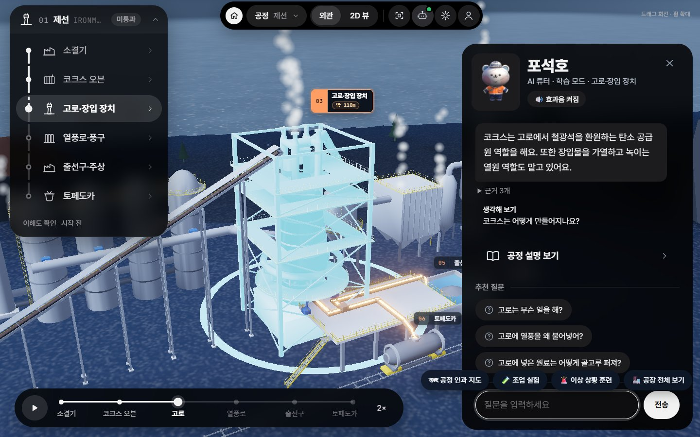
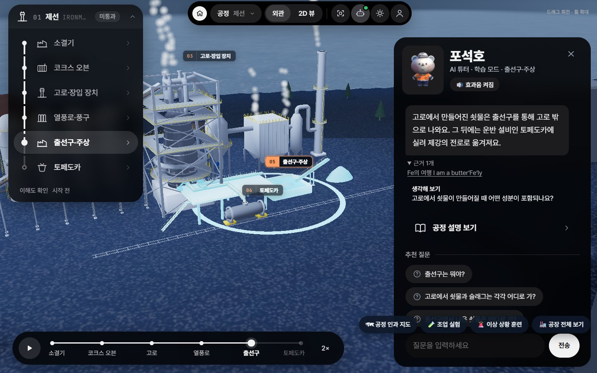
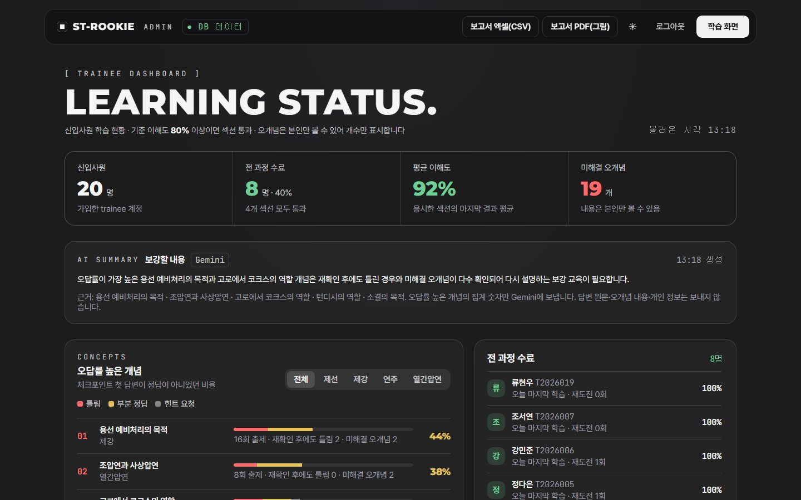
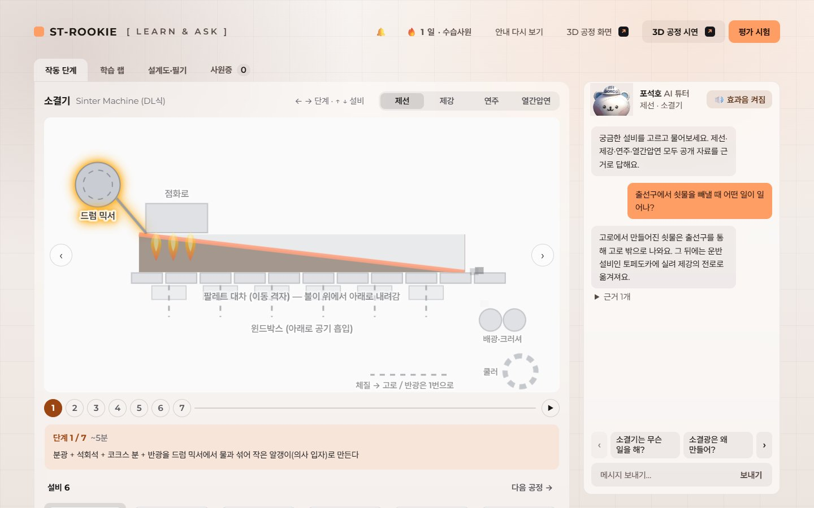
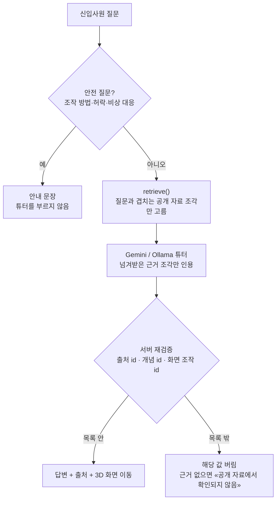
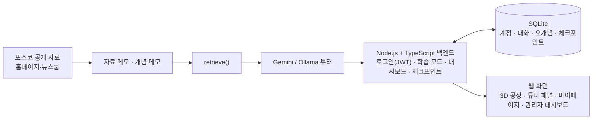

<h1 align="center">철든 신입 (ST-ROOKIE)</h1>

<p align="center">
  <b>제철소 신입사원 학습 서비스 — 팀 프로젝트에서 백엔드·AI 학습 튜터 담당</b><br>
  3D 공정 화면을 보며 질문하면 포스코 공개 자료에 근거해 답하고, 답에 맞춰 3D 화면이 해당 설비로 이동합니다.
</p>

<p align="center">
  <a href="https://github.com/steel-rookie/ST-ROOKIE"></a>
</p>

<p align="center">
  
  
  
  
  
  
  
</p>

<p align="center">
  <br>
  <sub>«고로에서 코크스는 어떤 역할을 해?» → 공개 자료 근거 3개로 답하고, 3D 화면이 <b>고로·장입 장치</b>로 이동</sub>
</p>

---

## 내 역할 한눈에

| | |
| --- | --- |
| **담당** | 학습 튜터(검색·답변·서버 재검증·3D 화면 조작), 로그인·계정 API, 관리자·본인 대시보드 API, 보충학습 Agent, 튜터 품질 측정·관측 |
| **비중** | 팀 `dev` 병합 제외 커밋 **482개 중 137개** (`git log --author=ssoyoum --author=박소영`) |
| **핵심 결과** | 제선 질문 **51문항 모두 통과**, 모델이 낸 출처·화면 조작 id를 서버가 목록과 다시 대조해 목록 밖 값은 버림 |
| **팀원 담당** | 이해도 확인(체크포인트) 채점 · 관리자/마이페이지 화면 · 3D 공정 모델과 화면 디자인 |
| **과정** | 포스코인재창조원 K-뉴딜 아카데미 「LLM 기반 스마트팩토리 AI Assistant 개발」 (2026.09~10) |

## 화면

<table>
  <tr>
    <td width="50%" align="center" valign="top">
      <b>근거 펼치기</b><br>
      <br>
      <sub>답 아래 «근거 n개»를 펼치면 인용한 포스코 공개 자료로 갑니다. 화면은 <b>출선구·주상</b>으로 이동.<br><b>내 담당</b>: 튜터 API, 출처 재검증, 3D 패널 연결(<code>learning-chat.js</code>)</sub>
    </td>
    <td width="50%" align="center" valign="top">
      <b>관리자 학습 현황</b><br>
      <br>
      <sub>신입사원·개념별 통계와 CSV·PDF 보고서. 오개념은 개수만 보입니다.<br><b>내 담당</b>: 통계 API·보고서 내보내기 · <b>팀원</b>: 화면, AI 요약</sub>
    </td>
  </tr>
  <tr>
    <td colspan="2" align="center" valign="top">
      <b>2D 학습 화면</b><br>
      <br>
      <sub>작동 단계 도식 옆에서도 같은 튜터 API로 답합니다. <b>내 담당</b>: 튜터 API · <b>팀원</b>: 화면</sub>
    </td>
  </tr>
</table>

<sub>캡처: 이 포크의 <code>dev</code>를 로컬에서 실행(Gemini), 관리자 화면은 <code>npm run db:seed-demo</code> 시연 기록 기준. 2026-11-08.</sub>

## 학습 튜터가 답하는 방식

모델이 자료에 없는 수치나 운전 조건을 지어낼 위험이 있어서, **검색은 튜터와 분리하고 모델의 출력은 서버가 다시 확인**합니다.



- 오개념을 감지하면 답의 첫 문장에서 바로잡고, 같은 오개념은 중복 기록하지 않습니다.
- `scene_actions`는 응답 형식(responseSchema)으로 한 번, 서버가 공정 4개·설비 24개 id 목록으로 한 번 더 걸러 최대 4개만 3D 화면에 전달합니다.
- 로컬 모델은 근거와 겹치는 문장이 없으면 `unverified`로 낮춥니다.

## 내가 한 일

| 영역 | 한 일 | 근거 커밋 |
|---|---|---|
| 학습 모드 튜터 | `retrieve()` 검색, Gemini 튜터, 단정형 오개념 감지, `scene_actions` 화면 조작, 대화 유지, 재시도, 스트리밍, 추천 질문·키워드 카드 | `dbf70b4` `8eb0d76` `7681fe8` `ba999b1` `c669146` |
| 로그인·계정 API | 아이디 + bcrypt 비밀번호 + JWT 회원가입·로그인·아이디 찾기·비밀번호 재설정, 역할, 시연 계정 20개. 체크포인트·학습 모드가 토큰의 사용자 id로 기록을 구분하게 연결 | `342f38b` `ce6e485` `8153a15` |
| 대시보드 연동 | 관리자용 신입사원·개념별 통계 API, 본인 대시보드 API, 진행 현황 CSV·PDF 보고서. 섹션 목록·시연 계정은 하드코딩 대신 서버에서 읽음 | `3f63033` `485cebd` `bdec8c9` `7e66563` `f147f19` |
| 보충학습 Agent | 열린 오개념을 다시 짚는 보충학습 흐름과 다중 턴 시나리오 평가 | `6a92296` `eeb23d9` |
| 품질 측정 | 질문 세트로 튜터를 측정하고, 근거가 없던 설비(출선구·토페도카 등)는 뉴스룸 기사로 보강 | `9c7d061` `97ff53c` |
| 관측·로컬 모델 | 요청 trace, Langfuse(OpenTelemetry) 내보내기, Gemini·Ollama 로컬 모델 전환과 비교 | `a01d541` `f200e56` `45cff20` `b6863b3` |
| 초기 MVP | LLM을 Gemini로 바꾸고 제선 질문 API와 단일 화면을 만들었습니다. 모델이 낸 출처가 자료 목록에 없으면 "확인할 수 없음"으로 대체. 팀 폴더 구성(`backend/frontend/llm/models`)으로 이전, 커밋 규칙·작업 기록 작성 | `2026-09-30` 커밋들 |
| 코드 리뷰 반영 | 같은 오개념 중복 기록, 개수 한도 없음, 안전 키워드가 교육 질문까지 막는 문제 수정 | `8945e14` |

## 측정한 것

| 무엇을 | 결과 |
|---|---|
| 제선 질문 세트로 학습 튜터 평가 | 첫 측정 24문항 중 23개 통과 → 질문을 늘린 뒤 **51문항 모두 통과** (2026-10-06) |
| 로컬 모델 3B vs 7B (57문항) | 통과율 82.5% / 75.4%, 응답 중앙값 29.3초 / 62.0초 |
| 로컬 모델의 근거 없는 답 | 12문항 중 틀린 답 3개를 `unverified`로 걸러냄 |

팀 개발 환경에서 한 번 돌린 값이며, 일반화한 성능이 아닙니다. 자세한 기록은 [`docs/learning-demo-ironmaking.md`](docs/learning-demo-ironmaking.md), [`docs/agent-roadmap.md`](docs/agent-roadmap.md)에 있습니다.

## 기술적 판단

- **검색과 튜터를 분리** — 근거 조각을 먼저 고른 뒤 그것만 모델에 넘기므로, 자료 원천이 바뀌어도 튜터 코드를 고치지 않습니다.
- **응답 형식 + 서버 검증** — 모델이 낸 출처·개념·화면 조작 id를 서버가 목록과 다시 대조해, 형식이 맞아도 목록 밖 값은 버립니다.
- **JWT + 기존 헤더 대체 경로** — 토큰이 있으면 토큰의 사용자 id를 쓰고, 없으면 기존 `X-User-Id`로 동작하게 해 아직 토큰을 보내지 않는 팀원 화면이 깨지지 않았습니다.
- **Gemini와 로컬 Ollama 전환** — 같은 튜터를 두 모델로 돌려 비교할 수 있게 했습니다. 키가 없으면 답변을 만들지 않고 미연결 상태를 보여 줍니다.
- **개인정보 범위는 API에서 먼저** — 관리자 통계에는 개수만, 답변 원문과 오개념 설명은 본인만 봅니다.

## 시스템 구성



## 내가 만든 API

| 영역 | 주요 API |
|---|---|
| 인증 | `POST /api/auth/signup`, `/login`, `/find-id`, `/reset-password`, `GET /api/auth/me`, `/api/auth/demo-accounts` |
| 학습 튜터 | `POST /api/chat`, `GET /api/chat/sessions/:sessionId` |
| 보충학습 | `GET·POST /api/learning/supplements`, `POST /api/learning/supplements/:id/answer`, `/scene-results`, `/stop` |
| 관리자 | `GET /api/admin/trainees`, `/api/admin/trainees/:id`, `/api/admin/concepts`, `/api/admin/report` |
| 본인 | `GET /api/me/dashboard`, `/api/me/misconceptions` |

API별 설명은 [`docs/auth-api.md`](docs/auth-api.md), [`docs/learning-mode.md`](docs/learning-mode.md), [`docs/admin-dashboard.md`](docs/admin-dashboard.md)에 있습니다.

## 협업 기준

- 여러 사람이 쓰는 API는 기존 호출을 살려 두고 단계적으로 옮겼습니다.
- 공용 규칙(DB 마이그레이션 번호, 계정 규칙)은 코드보다 `CLAUDE.md`·문서에 먼저 적어 같은 기준으로 개발했습니다.

## 실행

```powershell
npm.cmd ci
# .env 파일의 GEMINI_API_KEY= 뒤에 본인의 키 입력
npm.cmd start
```

<http://localhost:3000>을 엽니다. `.env`는 Git에서 제외됩니다. 시연 서버는 `npm.cmd run start:gemini`, 로컬 모델은 `npm.cmd run start:ollama`, 튜터 평가는 `npm.cmd run eval:learning`, 시연 기록 넣기는 `npm.cmd run db:seed-demo`입니다. 자료 범위는 [README-ko.txt](README-ko.txt)를 참고하세요.

## 저장소 원칙

이 레포는 팀 원본의 포크이고, README와 README용 캡처(`docs/readme/`)만 제 담당 중심으로 바꿨습니다. 코드와 나머지 문서는 팀 원본과 같습니다. 서비스 전체 설명과 팀원 담당 부분은 [원본 레포](https://github.com/steel-rookie/ST-ROOKIE)를 봐 주세요.
